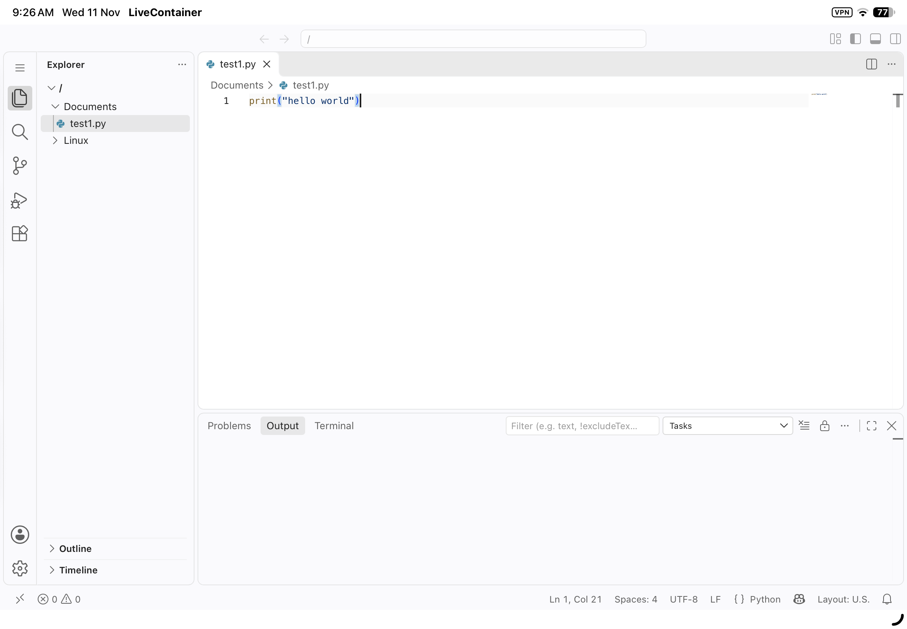

# VS Code for iOS

An experimental iOS port of [Code - OSS](https://github.com/microsoft/vscode), packaged as a native app for sideloading. It brings the VS Code web workbench to iPhone and iPad inside a Tauri app.

> **Status:** Early and experimental. Expect missing features and rough edges; this is not an official Microsoft product or a replacement for desktop VS Code.

## Preview



## What works

- The VS Code web workbench runs in an iOS `WKWebView`.
- The app includes a small local Rust HTTP server to serve the bundled web app.
- The workbench can access files in the app's `Documents/Linux` and `Documents/Documents` folders through the `ios:` file system integration.

## Limitations

This is a web-based port, not the full desktop application. In particular:

- There is no integrated terminal or Node.js extension host.
- Files created in the workbench are stored in browser IndexedDB; they are not automatically the same as files exposed through the `ios:` file system.
- Desktop-only functionality and extensions may not work on iOS.
- The project is still being developed and has not been fully tested end to end.

## Install

There is currently no App Store release. You can build an **unsigned IPA** with the repository's GitHub Actions workflow and sideload it using a compatible tool such as [LiveContainer](https://github.com/LiveContainer/LiveContainer) or AltStore.

1. Open the repository's [Actions](https://github.com/Anda2012/vscode_ios/actions) page.
2. Select **iOS Tauri unsigned IPA**.
3. Choose **Run workflow** and wait for the build to finish.
4. Open the completed workflow run, download the `Vscode-unsigned-ipa` artifact, and import the IPA into your sideloading app.

The artifact is unsigned, so it is not installable like a regular App Store app. Follow your sideloading tool's setup instructions. Builds from this workflow are temporary CI artifacts, not signed releases.

## Build from source

Building the iOS app requires macOS and Apple's iOS build tools. The CI workflow is the best reference for the current build steps:

1. Install the prerequisites used by the workflow: Node.js (version in `.nvmrc`), Rust stable with the `aarch64-apple-ios` target, Xcode, and XcodeGen.
2. From the repository root, build and stage the web app:

   ```sh
   tauri-ios/scripts/build-web.sh
   ```

3. Install the Tauri app dependencies and generate the app icons:

   ```sh
   cd tauri-ios
   npm install
   cp ../resources/linux/code.png app-icon.png
   npx tauri icon app-icon.png
   ```

4. Initialize and build the iOS project:

   ```sh
   npx tauri ios init
   npx tauri ios build --target aarch64 --no-sign
   ```

The build produces an unsigned app; signing and installing it on a device require an appropriate iOS development or sideloading setup.

## Contributing and issues

This repository is based on the [Visual Studio Code / Code - OSS](https://github.com/microsoft/vscode) project, with iOS-specific changes and an app wrapper. Contributions focused on making the iOS port better are welcome.

For upstream VS Code features and issues unrelated to this iOS port, see [microsoft/vscode](https://github.com/microsoft/vscode).

## License and attribution

This project is based on Code - OSS and is distributed under the [MIT License](LICENSE.txt). Visual Studio Code and related names and marks are trademarks of Microsoft. This independent iOS port is not an official Microsoft product.
